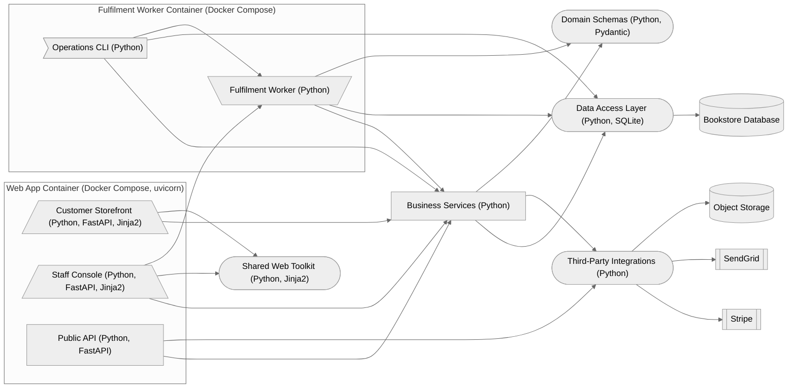
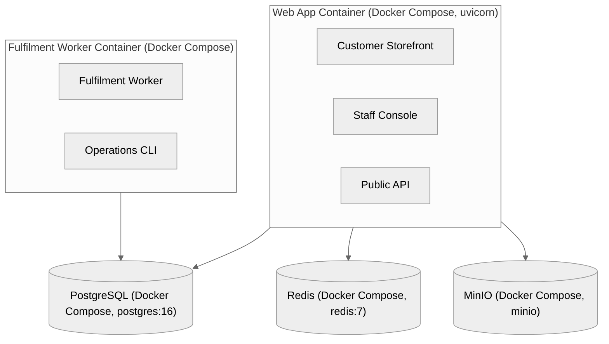

# Architecture

---

## Components

How work moves through the system. Modules that have components are drawn as containers.

```mermaid
%%{init: {'theme':'neutral'}}%%
graph LR
    subgraph Customer_Storefront["Customer Storefront (Python, FastAPI, Jinja2)"]
        Customer_Storefront_Storefront_Routes[/"Storefront Routes"\]
        Customer_Storefront_Storefront_Pages[/"Storefront Pages"\]
    end
    subgraph Staff_Console["Staff Console (Python, FastAPI, Jinja2)"]
        Staff_Console_Console_Routes[/"Console Routes"\]
        Staff_Console_Console_Pages[/"Console Pages"\]
    end
    subgraph Public_API["Public API (Python, FastAPI)"]
        Public_API_Catalogue_Feed["Catalogue Feed"]
        Public_API_Payment_Webhook["Payment Webhook"]
        Public_API_Ebook_Download["Ebook Download"]
    end
    subgraph Business_Services["Business Services (Python)"]
        Business_Services_Catalog["Catalog"]
        Business_Services_Checkout___Pricing["Checkout & Pricing"]
        Business_Services_Orders["Orders"]
        Business_Services_Payments["Payments"]
        Business_Services_Fulfilment_Jobs["Fulfilment Jobs"]
        Business_Services_Inventory["Inventory"]
        Business_Services_Customer_Identity["Customer Identity"]
        Business_Services_Notifications["Notifications"]
        Business_Services_Audit_Trail["Audit Trail"]
    end
    subgraph Data_Access_Layer["Data Access Layer (Python, SQLite)"]
        Data_Access_Layer_Connection___Schema(["Connection & Schema"])
        Data_Access_Layer_Catalogue_Repository(["Catalogue Repository"])
        Data_Access_Layer_Cart_Repository(["Cart Repository"])
        Data_Access_Layer_Customer_Repository(["Customer Repository"])
        Data_Access_Layer_Order_Repository(["Order Repository"])
        Data_Access_Layer_Payment_Repository(["Payment Repository"])
        Data_Access_Layer_Fulfilment_Repository(["Fulfilment Repository"])
        Data_Access_Layer_Inventory_Repository(["Inventory Repository"])
        Data_Access_Layer_Notification_Repository(["Notification Repository"])
        Data_Access_Layer_Audit_Repository(["Audit Repository"])
    end
    subgraph Third_Party_Integrations["Third-Party Integrations (Python)"]
        Third_Party_Integrations_Payment_Client(["Payment Client"])
        Third_Party_Integrations_Email_Client(["Email Client"])
        Third_Party_Integrations_File_Storage_Client(["File Storage Client"])
    end
    subgraph Shared_Web_Toolkit["Shared Web Toolkit (Python, Jinja2)"]
        Shared_Web_Toolkit_Templating(["Templating"])
        Shared_Web_Toolkit_Form_Helpers(["Form Helpers"])
        Shared_Web_Toolkit_Base_Layout(["Base Layout"])
    end
    Domain_Schemas(["Domain Schemas (Python, Pydantic)"])
    Fulfilment_Worker[\"Fulfilment Worker (Python)"/]
    subgraph Operations_CLI["Operations CLI (Python)"]
        Operations_CLI_Command_Dispatcher>"Command Dispatcher"]
        Operations_CLI_Demo_Data_Seeder>"Demo Data Seeder"]
    end

    Bookstore_Database[("Bookstore Database")]
    Stripe[["Stripe"]]
    SendGrid[["SendGrid"]]
    Object_Storage[("Object Storage")]

    Customer_Storefront_Storefront_Routes --> Customer_Storefront_Storefront_Pages
    Customer_Storefront_Storefront_Routes --> Business_Services_Catalog
    Customer_Storefront_Storefront_Routes --> Business_Services_Checkout___Pricing
    Customer_Storefront_Storefront_Routes --> Business_Services_Orders
    Customer_Storefront_Storefront_Routes --> Business_Services_Fulfilment_Jobs
    Customer_Storefront_Storefront_Routes --> Business_Services_Customer_Identity
    Customer_Storefront_Storefront_Routes --> Shared_Web_Toolkit_Templating
    Customer_Storefront_Storefront_Routes --> Shared_Web_Toolkit_Form_Helpers
    Customer_Storefront_Storefront_Pages --> Shared_Web_Toolkit_Base_Layout
    Staff_Console_Console_Routes --> Staff_Console_Console_Pages
    Staff_Console_Console_Routes --> Business_Services_Audit_Trail
    Staff_Console_Console_Routes --> Business_Services_Catalog
    Staff_Console_Console_Routes --> Business_Services_Fulfilment_Jobs
    Staff_Console_Console_Routes --> Business_Services_Inventory
    Staff_Console_Console_Routes --> Business_Services_Notifications
    Staff_Console_Console_Routes --> Business_Services_Orders
    Staff_Console_Console_Routes --> Business_Services_Payments
    Staff_Console_Console_Routes --> Fulfilment_Worker
    Staff_Console_Console_Routes --> Shared_Web_Toolkit_Templating
    Staff_Console_Console_Routes --> Shared_Web_Toolkit_Form_Helpers
    Staff_Console_Console_Pages --> Shared_Web_Toolkit_Base_Layout
    Public_API_Catalogue_Feed --> Business_Services_Catalog
    Public_API_Payment_Webhook --> Business_Services_Payments
    Public_API_Ebook_Download --> Business_Services_Fulfilment_Jobs
    Public_API_Ebook_Download --> Third_Party_Integrations_File_Storage_Client
    Business_Services_Catalog --> Data_Access_Layer_Catalogue_Repository
    Business_Services_Catalog --> Third_Party_Integrations_File_Storage_Client
    Business_Services_Catalog --> Domain_Schemas
    Business_Services_Checkout___Pricing --> Business_Services_Catalog
    Business_Services_Checkout___Pricing --> Business_Services_Inventory
    Business_Services_Checkout___Pricing --> Business_Services_Orders
    Business_Services_Checkout___Pricing --> Business_Services_Payments
    Business_Services_Checkout___Pricing --> Business_Services_Customer_Identity
    Business_Services_Checkout___Pricing --> Data_Access_Layer_Cart_Repository
    Business_Services_Checkout___Pricing --> Domain_Schemas
    Business_Services_Orders --> Business_Services_Notifications
    Business_Services_Orders --> Business_Services_Fulfilment_Jobs
    Business_Services_Orders --> Data_Access_Layer_Order_Repository
    Business_Services_Orders --> Domain_Schemas
    Business_Services_Payments --> Business_Services_Orders
    Business_Services_Payments --> Business_Services_Notifications
    Business_Services_Payments --> Data_Access_Layer_Order_Repository
    Business_Services_Payments --> Data_Access_Layer_Payment_Repository
    Business_Services_Payments --> Third_Party_Integrations_Payment_Client
    Business_Services_Payments --> Domain_Schemas
    Business_Services_Fulfilment_Jobs --> Data_Access_Layer_Fulfilment_Repository
    Business_Services_Inventory --> Data_Access_Layer_Inventory_Repository
    Business_Services_Customer_Identity --> Data_Access_Layer_Customer_Repository
    Business_Services_Customer_Identity --> Domain_Schemas
    Business_Services_Notifications --> Data_Access_Layer_Notification_Repository
    Business_Services_Notifications --> Third_Party_Integrations_Email_Client
    Business_Services_Audit_Trail --> Data_Access_Layer_Audit_Repository
    Data_Access_Layer_Connection___Schema --> Bookstore_Database
    Data_Access_Layer_Catalogue_Repository --> Data_Access_Layer_Connection___Schema
    Data_Access_Layer_Cart_Repository --> Data_Access_Layer_Connection___Schema
    Data_Access_Layer_Customer_Repository --> Data_Access_Layer_Connection___Schema
    Data_Access_Layer_Order_Repository --> Data_Access_Layer_Connection___Schema
    Data_Access_Layer_Payment_Repository --> Data_Access_Layer_Connection___Schema
    Data_Access_Layer_Fulfilment_Repository --> Data_Access_Layer_Connection___Schema
    Data_Access_Layer_Inventory_Repository --> Data_Access_Layer_Connection___Schema
    Data_Access_Layer_Notification_Repository --> Data_Access_Layer_Connection___Schema
    Data_Access_Layer_Audit_Repository --> Data_Access_Layer_Connection___Schema
    Third_Party_Integrations_Payment_Client --> Stripe
    Third_Party_Integrations_Email_Client --> SendGrid
    Third_Party_Integrations_File_Storage_Client --> Object_Storage
    Shared_Web_Toolkit_Templating --> Shared_Web_Toolkit_Base_Layout
    Fulfilment_Worker --> Business_Services
    Fulfilment_Worker --> Data_Access_Layer
    Fulfilment_Worker --> Domain_Schemas
    Operations_CLI_Command_Dispatcher --> Operations_CLI_Demo_Data_Seeder
    Operations_CLI_Command_Dispatcher --> Fulfilment_Worker
    Operations_CLI_Command_Dispatcher --> Data_Access_Layer_Connection___Schema
    Operations_CLI_Command_Dispatcher --> Business_Services_Catalog
    Operations_CLI_Command_Dispatcher --> Business_Services_Fulfilment_Jobs
    Operations_CLI_Command_Dispatcher --> Business_Services_Inventory
    Operations_CLI_Command_Dispatcher --> Business_Services_Orders
    Operations_CLI_Demo_Data_Seeder --> Data_Access_Layer_Catalogue_Repository
    Operations_CLI_Demo_Data_Seeder --> Data_Access_Layer_Customer_Repository
    Operations_CLI_Demo_Data_Seeder --> Data_Access_Layer_Inventory_Repository
    Operations_CLI_Demo_Data_Seeder --> Data_Access_Layer_Order_Repository
    Operations_CLI_Demo_Data_Seeder --> Data_Access_Layer_Payment_Repository
    Operations_CLI_Demo_Data_Seeder --> Business_Services_Customer_Identity
```

Show the component diagram

---

### Customer Storefront `Python, FastAPI, Jinja2`

Server-rendered shop where customers browse books, manage a cart, check out and view their orders.

**Path:** `apps/storefront`

**Depends on:** Business Services, Shared Web Toolkit

- **Storefront Routes** — Handles browsing, search, cart, checkout, sign-in and account requests and renders the matching page.
- **Storefront Pages** — HTML templates for the catalogue, book detail, cart, checkout, login and account pages.

### Staff Console `Python, FastAPI, Jinja2`

Back-office pages for staff to manage books, inventory, orders, fulfilment jobs, the email outbox and the audit log.

**Path:** `apps/admin`

**Depends on:** Business Services, Shared Web Toolkit, Fulfilment Worker

- **Console Routes** — Handles staff actions on books, stock, orders, refunds, jobs and the outbox, recording each in the audit log.
- **Console Pages** — HTML templates for the dashboard, book editor, inventory, orders, jobs, outbox and audit views.

### Public API `Python, FastAPI`

Unauthenticated machine-facing endpoints for the partner catalogue feed, the Stripe payment webhook and ebook downloads.

**Path:** `apps/api`

**Depends on:** Business Services, Third-Party Integrations

- **Catalogue Feed** — Publishes the book catalogue as a stable JSON contract consumed by partners.
- **Payment Webhook** — Receives signed Stripe payment confirmations and hands them to the payment service.
- **Ebook Download** — Serves a purchased ebook file in exchange for a one-off, time-limited download token.

### Business Services `Python`

Domain logic for the bookshop, sitting between the web layer and the data repositories.

**Path:** `services`

**Depends on:** Data Access Layer, Third-Party Integrations, Domain Schemas

- **Catalog** — Looks up books and their physical and digital editions and resolves cover image URLs.
- **Checkout & Pricing** — Manages guest and signed-in carts, prices them with VAT and legacy discounts, and turns them into paid orders.
- **Orders** — Creates orders, moves them through their lifecycle and notifies customers of changes.
- **Payments** — Charges and refunds customers through Stripe and reconciles webhook events with orders.
- **Fulfilment Jobs** — Queues fulfilment and reconciliation jobs and manages download grants for ebooks.
- **Inventory** — Tracks stock levels for physical editions and flags titles that need reordering.
- **Customer Identity** — Registers and authenticates customers, manages sessions and identifies legacy-pricing accounts.
- **Notifications** — Records every transactional email in an outbox and sends it to customers.
- **Audit Trail** — Records staff actions for the audit log.

### Data Access Layer `Python, SQLite`

Owns the database schema and connection, and exposes one repository per domain area.

**Path:** `data`

**Depends on:** Bookstore Database

- **Connection & Schema** — Opens database connections, defines the schema and runs queries for every repository.
- **Catalogue Repository** — Reads and writes books and their editions.
- **Cart Repository** — Persists the carts of signed-in customers.
- **Customer Repository** — Stores customer accounts and sessions.
- **Order Repository** — Stores orders, their line items and status changes.
- **Payment Repository** — Stores charges, refunds and processed webhook events.
- **Fulfilment Repository** — Holds the job queue, shipments and ebook download grants.
- **Inventory Repository** — Stores stock counts for physical editions.
- **Notification Repository** — Stores the outbox of transactional emails.
- **Audit Repository** — Stores the audit log of staff actions.

### Third-Party Integrations `Python`

Clients for payments, email and object storage that fall back to local mocks when no credentials are set.

**Path:** `integrations`

**Depends on:** Stripe, SendGrid, Object Storage

- **Payment Client** — Creates charges and refunds and verifies and parses payment webhooks.
- **Email Client** — Delivers transactional email, or reports success without sending in mock mode.
- **File Storage Client** — Resolves cover URLs and reads ebook files from a bucket or the local filesystem.

### Shared Web Toolkit `Python, Jinja2`

Shared templating setup, base layout and form helpers used by the storefront and staff console.

**Path:** `packages/web`

- **Templating** — Builds each app's template engine with the shared layout as a fallback and a money formatting filter.
- **Form Helpers** — Parses submitted form data and coerces fields to the right types.
- **Base Layout** — The common page shell that every storefront and console page extends.

### Domain Schemas `Python, Pydantic`

Shared data models for books, carts, customers, orders, payments and fulfilment.

**Path:** `packages/schemas`

### Fulfilment Worker `Python`

Drains the job queue, granting ebook downloads or shipping physical copies and reconciling inventory.

**Path:** `workers/fulfillment`

**Depends on:** Business Services, Data Access Layer, Domain Schemas

### Operations CLI `Python`

Command-line tool for seeding the database, running fulfilment and reporting store status from the terminal.

**Path:** `tools/cli`

**Depends on:** Business Services, Data Access Layer, Fulfilment Worker

- **Command Dispatcher** — Runs the seed, fulfil, reconcile and status commands.
- **Demo Data Seeder** — Loads the book catalogue, demo customers and sample orders from the seed file.

---

## Deployment

**Web App Container** `Docker Compose, uvicorn`
: Serves the storefront, staff console and public API as one ASGI app on port 8000.
  Hosts: Customer Storefront, Staff Console, Public API
  Depends on: PostgreSQL, Redis, MinIO

**Fulfilment Worker Container** `Docker Compose`
: Runs the fulfilment loop through the operations CLI.
  Hosts: Fulfilment Worker, Operations CLI
  Depends on: PostgreSQL

**PostgreSQL** `Docker Compose, postgres:16`
: Database server declared in the compose topology.

**Redis** `Docker Compose, redis:7`
: Cache server declared in the compose topology.

**MinIO** `Docker Compose, minio`
: S3-compatible object store for covers and ebook files.
