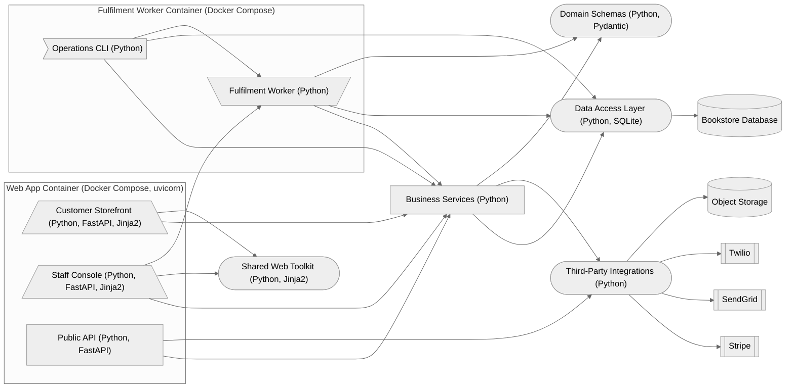
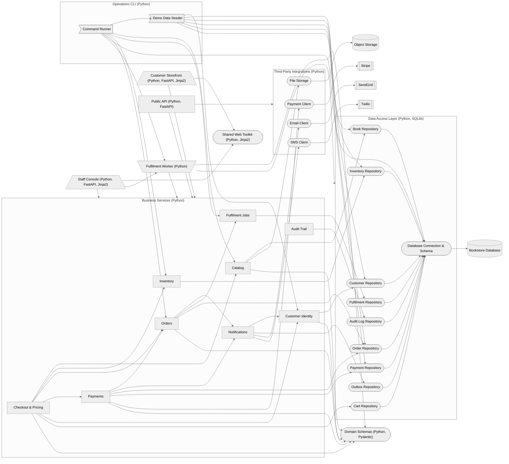
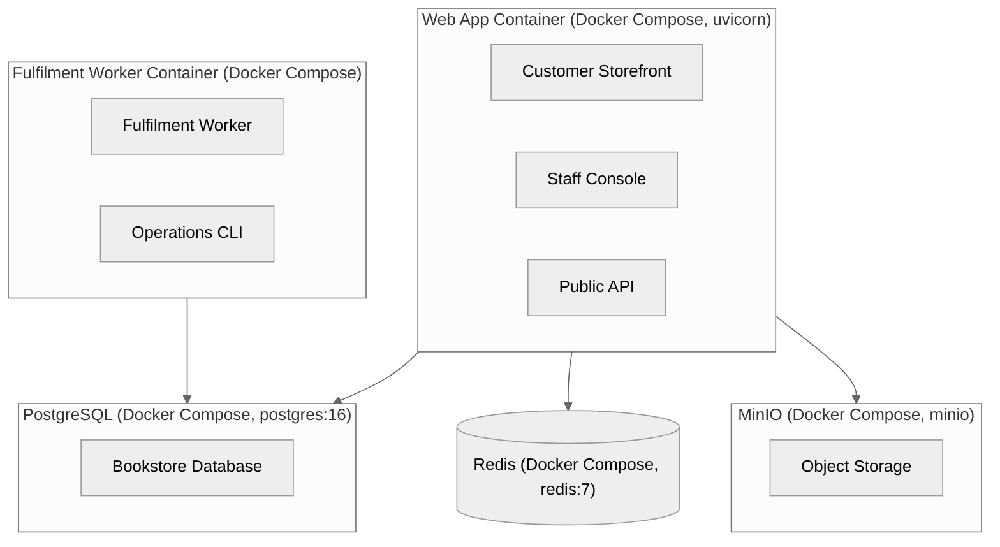

# Architecture

---

## Components

How work moves through the system. Modules that have components are drawn as containers.

Show the component diagram

---

### Customer Storefront `Python, FastAPI, Jinja2`

Server-rendered shop where customers browse books, manage a cart, check out and view their orders.

**Path:** `apps/storefront`

**Depends on:** Business Services, Shared Web Toolkit

### Staff Console `Python, FastAPI, Jinja2`

Back-office pages for staff to manage books, inventory, orders, fulfilment jobs, the message outbox and the audit log.

**Path:** `apps/admin`

**Depends on:** Business Services, Shared Web Toolkit, Fulfilment Worker

### Public API `Python, FastAPI`

JSON endpoints for the catalogue, ebook downloads and the Stripe payment webhook.

**Path:** `apps/api`

**Depends on:** Business Services, Third-Party Integrations

### Business Services `Python`

Domain logic for the bookshop, sitting between the web layer and the data repositories.

**Path:** `services`

**Depends on:** Data Access Layer, Third-Party Integrations, Domain Schemas

- **Catalog** — Looks up books, their physical and digital editions, and bestseller lists.
- **Checkout & Pricing** — Manages guest and signed-in carts, prices them and turns them into paid orders.
- **Orders** — Creates orders and moves them through their lifecycle.
- **Payments** — Charges customers through Stripe and reconciles webhook events with orders.
- **Fulfilment Jobs** — Queues fulfilment work and manages download grants for ebooks.
- **Inventory** — Tracks stock levels for physical editions.
- **Customer Identity** — Registers and authenticates customers and manages sessions.
- **Notifications** — Records and sends transactional emails and text messages to customers.
- **Audit Trail** — Records staff actions for the audit log.

### Data Access Layer `Python, SQLite`

Owns the database schema and connection, and exposes one repository per domain area.

**Path:** `data`

**Depends on:** Bookstore Database

- **Database Connection & Schema** — Opens the database connection, runs queries and creates the schema.
- **Book Repository** — Reads and writes books and editions, and ranks bestsellers from paid orders.
- **Inventory Repository** — Reads and adjusts stock levels for physical editions.
- **Customer Repository** — Stores customer accounts and login sessions.
- **Cart Repository** — Persists carts for signed-in shoppers.
- **Order Repository** — Stores orders, their line items and status changes.
- **Payment Repository** — Stores payment and refund records.
- **Fulfilment Repository** — Stores shipments, ebook download grants and the background job queue.
- **Outbox Repository** — Records every email and text message sent to customers.
- **Audit Log Repository** — Stores the audit trail of staff actions.

### Third-Party Integrations `Python`

Clients for payments, email, text messages and object storage that fall back to local mocks when no credentials are set.

**Path:** `integrations`

**Depends on:** Stripe, SendGrid, Twilio, Object Storage

- **Payment Client** — Creates charges and refunds and verifies payment webhook signatures.
- **Email Client** — Sends transactional emails.
- **SMS Client** — Sends text messages.
- **File Storage** — Resolves and reads cover images and ebook files from a bucket or local disk.

### Shared Web Toolkit `Python, Jinja2`

Shared templating setup, base layout and form helpers used by the storefront and staff console.

**Path:** `packages/web`

### Domain Schemas `Python, Pydantic`

Shared data models for books, carts, customers, orders, payments and fulfilment.

**Path:** `packages/schemas`

### Fulfilment Worker `Python`

Drains the job queue, granting ebook downloads or shipping physical copies and reconciling inventory.

**Path:** `workers/fulfillment`

**Depends on:** Business Services, Data Access Layer, Domain Schemas

### Operations CLI `Python`

Command-line tool for seeding the database and running fulfilment from the terminal.

**Path:** `tools/cli`

**Depends on:** Business Services, Data Access Layer, Fulfilment Worker

- **Command Runner** — Parses terminal commands and dispatches them to seeding, stock and fulfilment operations.
- **Demo Data Seeder** — Loads the demo catalogue, customer accounts and order history.

---

## Deployment

**Web App Container** `Docker Compose, uvicorn`
: Serves the storefront, staff console and public API as one ASGI app on port 8000.
  Hosts: Customer Storefront, Staff Console, Public API
  Depends on: PostgreSQL, Redis, MinIO

**Fulfilment Worker Container** `Docker Compose`
: Runs the fulfilment loop through the operations CLI.
  Hosts: Fulfilment Worker, Operations CLI
  Depends on: PostgreSQL

**PostgreSQL** `Docker Compose, postgres:16`
: Database server declared in the compose topology.
  Hosts: Bookstore Database

**Redis** `Docker Compose, redis:7`
: Cache server declared in the compose topology but not used by any code.

**MinIO** `Docker Compose, minio`
: S3-compatible object store for covers and ebook files.
  Hosts: Object Storage
